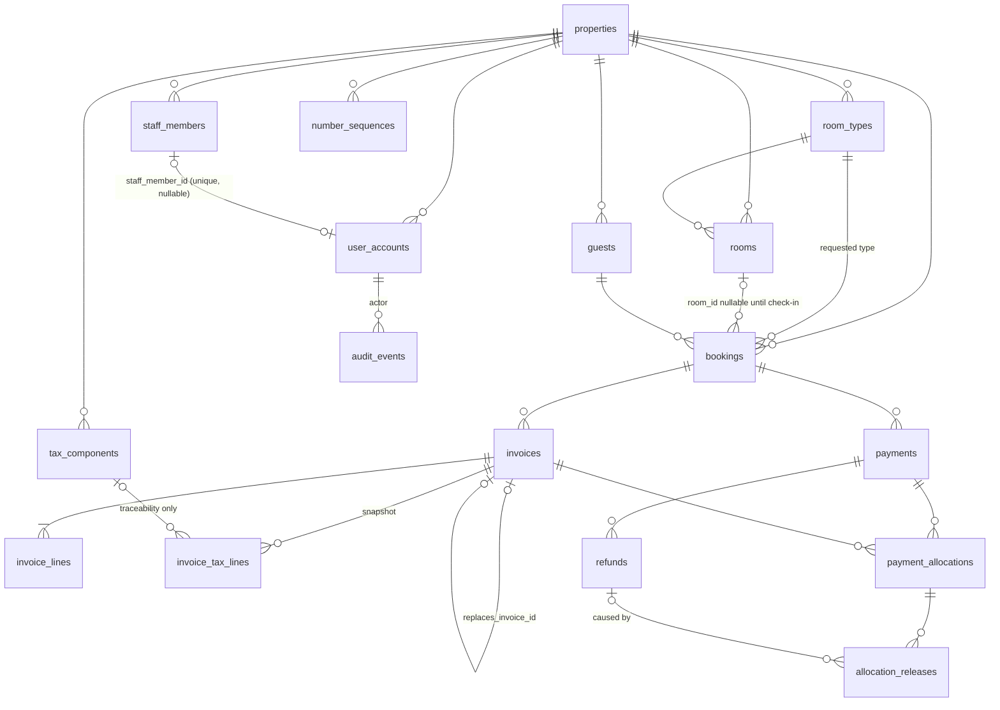

# DATABASE.md: StayDesk MySQL design (Gate 2, proposed)

> **Status: APPROVED (Gate 2, 2026-11-09), with decisions DB1–DB8 accepted as proposed.** It is
> implemented in Gate 3 by the migrations in `backend/src/db/migrations/`, and those migrations are
> the source of truth. Keep this file in step with them.
> **Source:** the approved domain model [domain/data-model.md](domain/data-model.md) (Gate 1,
> 2026-11-09). Every table traces to an entity there, and every constraint traces to a rule (R#) or
> financial invariant (F#). Where the domain still has an open question, the table follows the
> working assumption and names the question (Q#). Changing that answer may change the table.
> **Customer-facing version:** [dsd/data-model.md](dsd/data-model.md).

## 1. Conventions

| Topic | Decision | Why |
|---|---|---|
| Engine | MySQL **8.4 LTS**, InnoDB, `utf8mb4` / `utf8mb4_0900_ai_ci` | Row locks and transactions (F1.8). `CHECK` constraints are enforced since 8.0.16 |
| Primary keys | `id BIGINT UNSIGNED AUTO_INCREMENT`, internal only | Never shown as a business number (R14, F2.2) |
| Business numbers | Separate columns (`reference`, `invoice_number`), unique **per property** | R14 |
| Tenant key | `property_id` on every property-owned table, FK to `properties` | Q1 (single property in Release 1, multi-ready) |
| Money | `DECIMAL(12,2)`, never `FLOAT`/`DOUBLE`. `CHECK (amount > 0)` on financial rows | D4, R13, F1.1 |
| Rates | `DECIMAL(7,4)` percent (e.g. `12.0000`) | Q6. Allows rates like 2.5% |
| Business dates | `DATE` (stay dates, issue date) in the **property timezone** | Avoids a stay date moving when converted to UTC |
| Moments | `DATETIME(3)`, stored in **UTC** | Audit and ordering |
| Status columns | `ENUM` with the exact domain values | A closed list, checked by the DB |
| Foreign keys | Always declared, `ON DELETE RESTRICT ON UPDATE RESTRICT` | Nothing financial can disappear by cascade (F1.7) |
| Row audit | `created_at`, `created_by_user_id` on every table, plus `updated_at` where updates are allowed | §11 audit |
| Naming | `snake_case`, plural table names, `<table>_id` for FKs | — |

## 2. Entity-relationship diagram

## 3. Tables

Common columns are not repeated below: `id`, `created_at`, `created_by_user_id` (FK
`user_accounts`, nullable for seed/system rows), and `property_id` (FK, NOT NULL) on every table
except `properties`, the child line tables and `audit_events`.

### 3.1 Property and people

**`properties`** (§5 Property)
| Column | Type | Constraint / note |
|---|---|---|
| code | VARCHAR(40) | UNIQUE. Matches the BFF `HOTEL_SLUG` |
| name, address | VARCHAR(160), VARCHAR(500) | NOT NULL |
| phone, email | VARCHAR(40), VARCHAR(254) | |
| country_code | CHAR(2) | ISO 3166, NOT NULL (Q1b, fixes G6) |
| currency | CHAR(3) | ISO 4217, NOT NULL (`INR`) |
| timezone | VARCHAR(64) | IANA, NOT NULL (`Asia/Kolkata`) |
| check_in_time, check_out_time | TIME | NOT NULL |
| updated_at | DATETIME(3) | |

**`staff_members`** (D3: the person)
| Column | Type | Constraint / note |
|---|---|---|
| full_name | VARCHAR(160) | NOT NULL |
| email | VARCHAR(254) | |
| job_title | VARCHAR(60) | Free text (Receptionist, Manager…). Not a permission (G7) |
| is_active | BOOLEAN | NOT NULL DEFAULT TRUE |
| updated_at | DATETIME(3) | |

**`user_accounts`** (D3: the login identity)
| Column | Type | Constraint / note |
|---|---|---|
| username | VARCHAR(60) | **UNIQUE (property_id, username)** |
| password_hash | VARCHAR(100) | bcrypt hash only. A plain password is never stored or logged |
| role | ENUM('front_desk','admin','super_admin') | NOT NULL (§10) |
| staff_member_id | BIGINT UNSIGNED NULL | FK, **UNIQUE**, so a staff member has at most one login (Q14) |
| is_active | BOOLEAN | NOT NULL. Inactive accounts cannot sign in (R15) |
| last_login_at | DATETIME(3) NULL | |
| updated_at | DATETIME(3) | |

### 3.2 Inventory

**`room_types`**
| Column | Type | Constraint / note |
|---|---|---|
| code, name | VARCHAR(30), VARCHAR(80) | UNIQUE (property_id, code) |
| base_rate | DECIMAL(12,2) | CHECK > 0. Rate per type (Q5) |
| capacity | TINYINT UNSIGNED | CHECK ≥ 1 (R7) |
| is_active | BOOLEAN | |
| updated_at | DATETIME(3) | |

**`rooms`**
| Column | Type | Constraint / note |
|---|---|---|
| room_type_id | FK | NOT NULL |
| number | VARCHAR(10) | **UNIQUE (property_id, number)** (R14) |
| floor | SMALLINT | |
| is_out_of_service | BOOLEAN | NOT NULL DEFAULT FALSE. This is the only stored operational flag (`maintenance`) |
| housekeeping_status | ENUM('clean','dirty','inspecting') | NOT NULL DEFAULT 'clean'. Independent of the above (R4) |
| updated_at | DATETIME(3) | |

**Room status is not a column (D2, R1–R3).** It is derived:
`maintenance` if `is_out_of_service`, else `occupied` if a `checked_in` booking has this `room_id`,
else `available`. There is no `reserved` anywhere (G1).

### 3.3 Guests and bookings

**`guests`**
| Column | Type | Constraint / note |
|---|---|---|
| full_name | VARCHAR(160) | NOT NULL. Index (property_id, full_name) |
| email, phone | VARCHAR(254), VARCHAR(40) | PII. Never logged (§11, Q19) |
| country_code | CHAR(2) | |
| is_vip | BOOLEAN | |
| updated_at | DATETIME(3) | |

`stays` and `last_stay` are derived from bookings (§9). Retention and ID-document columns wait for
Q19 and are **required before production**.

**`bookings`**
| Column | Type | Constraint / note |
|---|---|---|
| reference | VARCHAR(20) | **UNIQUE (property_id, reference)**. Unique, and gaps are allowed (Q11) |
| guest_id | FK | NOT NULL |
| room_type_id | FK | NOT NULL (the requested type) |
| room_id | FK NULL | Assigned by check-in at the latest (Q3) |
| check_in_date, check_out_date | DATE | **CHECK (check_out_date > check_in_date)** (R5) |
| guests_count | TINYINT UNSIGNED | CHECK ≥ 1. The capacity check (R7) is in the service, because it needs the room type |
| source | ENUM('direct','booking_com','expedia','walk_in','phone') | Labels only (Q9) |
| status | ENUM('pending','confirmed','checked_in','checked_out','cancelled') | |
| nightly_rate | DECIMAL(12,2) | **A snapshot** of the rate when booked. CHECK > 0 |
| room_total | DECIMAL(12,2) | nightly_rate × nights, net of tax (R6). CHECK > 0 |
| expected_arrival_time | TIME NULL | Q18 |
| checked_in_at, checked_out_at, cancelled_at | DATETIME(3) NULL | |
| cancellation_reason | VARCHAR(500) NULL | |
| occupied_room_id | BIGINT UNSIGNED, **generated** `IF(status='checked_in', room_id, NULL)` STORED | **UNIQUE**. A room can hold at most one checked-in booking, enforced by the DB (R2, R8). MySQL allows any number of NULLs in a unique index |
| updated_at | DATETIME(3) | |

Constraints:
- `CHECK (status NOT IN ('checked_in','checked_out') OR room_id IS NOT NULL)`: a stay needs a room.
- Indexes: (property_id, check_in_date), (property_id, check_out_date), (room_id, check_in_date,
  check_out_date), (guest_id).
- **Overlap (R8) cannot be a MySQL constraint**, because MySQL has no exclusion constraints. It is
  enforced in the transaction that assigns a room: lock the `rooms` row `FOR UPDATE`, check for
  overlapping non-cancelled bookings on that room, then write. The generated unique column above is
  the DB backstop for the most important case (two guests checked into one room).

### 3.4 Tax configuration and numbering

**`tax_components`** (Q6, F4.3)
| Column | Type | Constraint / note |
|---|---|---|
| code, name | VARCHAR(20), VARCHAR(80) | e.g. `GST`, or `CGST` + `SGST` |
| rate_percent | DECIMAL(7,4) | CHECK ≥ 0 |
| applies_to | ENUM('room','penalty') | Q6d, Q13e |
| apply_order | TINYINT UNSIGNED | |
| effective_from | DATE | NOT NULL |
| effective_to | DATE NULL | CHECK (effective_to IS NULL OR effective_to > effective_from) |

- UNIQUE (property_id, code, applies_to, effective_from). `applies_to` was added in Gate 3, so the
  same code (e.g. GST) can exist for both room and penalty charges.
- A component is valid for `effective_from ≤ date < effective_to` (`effective_to` is exclusive,
  NULL means open-ended).
- **Never updated in place once used (F4.3).** A rate change sets `effective_to` on the old row and
  inserts a new one. A trigger blocks changes to `rate_percent`/`code` on any row referenced by
  `invoice_tax_lines`.
- Non-overlapping periods per code are checked by the service, in a transaction.
- **There is no `tax_rate` column on `properties`.** The 12% exists only as seed data (G11).

**`number_sequences`** (Q11, F2)
| Column | Type | Constraint / note |
|---|---|---|
| document_type | ENUM('invoice') | Extendable later (receipt vouchers, Q24; credit notes, Q11e) |
| series | VARCHAR(20) | e.g. financial year `2026-27` (Q11b) |
| prefix | VARCHAR(20) | e.g. `INV/2026-27/` |
| next_value | INT UNSIGNED | CHECK ≥ 1 |
| updated_at | DATETIME(3) | |

UNIQUE (property_id, document_type, series). There is one row per series, and it is the lock target
for F2.1.

### 3.5 Invoices

**`invoices`** (only issued invoices are stored. There are no drafts in Release 1, so a number exists
from the moment the row exists: F2.3)
| Column | Type | Constraint / note |
|---|---|---|
| booking_id | FK | NOT NULL |
| invoice_type | ENUM('stay','penalty') | Q7, Q13 |
| series | VARCHAR(20) | Copied from the sequence row |
| sequence_number | INT UNSIGNED | **UNIQUE (property_id, series, sequence_number)**: the F2.1 backstop |
| invoice_number | VARCHAR(40) | prefix + zero-padded number. **UNIQUE (property_id, invoice_number)** |
| issue_date | DATE | Property timezone |
| issued_at | DATETIME(3) | UTC |
| net_amount | DECIMAL(12,2) | CHECK ≥ 0 |
| tax_amount | DECIMAL(12,2) | CHECK ≥ 0 |
| gross_amount | DECIMAL(12,2) | **CHECK (gross_amount = net_amount + tax_amount)** |
| rounding_rule | VARCHAR(30) | The rule used, stored with the invoice (F4.4, Q6c) |
| status | ENUM('issued','void') | Only `void` is stored. `unpaid/partial/paid` are **derived** from allocations (§5) |
| void_reason | VARCHAR(500) NULL | |
| voided_at | DATETIME(3) NULL | |
| voided_by_user_id | FK NULL | |
| replaces_invoice_id | FK → invoices NULL | A correction after a void (F2.5) |

- `CHECK ((status='void') = (voided_at IS NOT NULL AND void_reason IS NOT NULL))`.
- **Immutability (F4.2):** a `BEFORE UPDATE` trigger rejects any change except `issued → void` with
  the void columns. A `BEFORE DELETE` trigger rejects all deletes. Voided rows and their numbers stay
  for ever (F2.4).

**`invoice_lines`**
| Column | Type | Constraint / note |
|---|---|---|
| invoice_id | FK | NOT NULL |
| line_no | SMALLINT | UNIQUE (invoice_id, line_no) |
| description | VARCHAR(200) | e.g. "Deluxe room, 3 nights" |
| quantity | DECIMAL(8,2) | CHECK > 0 |
| unit_price | DECIMAL(12,2) | CHECK ≥ 0 |
| line_net | DECIMAL(12,2) | CHECK ≥ 0 |
| tax_category | ENUM('room','penalty') | Links the line to the components that apply |

**`invoice_tax_lines`**: the tax snapshot (F4.1)
| Column | Type | Constraint / note |
|---|---|---|
| invoice_id | FK | NOT NULL |
| tax_component_id | FK NULL | For traceability only. **The figures below are what count** |
| component_code, component_name | VARCHAR(20), VARCHAR(80) | Copied |
| rate_percent | DECIMAL(7,4) | Copied |
| taxable_base | DECIMAL(12,2) | CHECK ≥ 0 |
| tax_amount | DECIMAL(12,2) | CHECK ≥ 0 |
| apply_order | TINYINT UNSIGNED | |

UNIQUE (invoice_id, component_code). `invoice_lines` and `invoice_tax_lines` have triggers that
reject every UPDATE and DELETE.

### 3.6 Money in, allocations and refunds

**`payments`** (money received, against a booking: Q23, R16)
| Column | Type | Constraint / note |
|---|---|---|
| booking_id | FK | NOT NULL |
| reference | VARCHAR(20) | **UNIQUE (property_id, reference)** |
| method | ENUM('card','upi','cash','bank_transfer') | |
| amount | DECIMAL(12,2) | **CHECK > 0** (F1.1) |
| status | ENUM('pending','success','failed') | There is no `refunded` (R18, G9) |
| received_at | DATETIME(3) | |
| external_ref | VARCHAR(100) NULL | Card or UPI transaction id. Never card data |
| updated_at | DATETIME(3) | |

Trigger: `amount`, `booking_id`, `method` and `reference` are immutable. `status` may only move
`pending → success` or `pending → failed`. Deletes are rejected (F1.7).

**`payment_allocations`** (payment ↔ invoice, many-to-many: Q23)
| Column | Type | Constraint / note |
|---|---|---|
| payment_id | FK | NOT NULL |
| invoice_id | FK | NOT NULL |
| amount | DECIMAL(12,2) | **CHECK > 0** |
| allocated_at | DATETIME(3) | |

These rows are never updated or deleted (trigger). Indexes: (payment_id), (invoice_id).

**`allocation_releases`** (how R19 works without editing or using negative rows: F1.1, F1.7)
| Column | Type | Constraint / note |
|---|---|---|
| payment_allocation_id | FK | NOT NULL |
| amount | DECIMAL(12,2) | **CHECK > 0** |
| reason | ENUM('refund','invoice_void','correction') | |
| refund_id | FK NULL | Set when reason = refund |
| released_at | DATETIME(3) | |

**Net allocation** = allocation amount − Σ its releases. These rows are never updated or deleted.

**`refunds`** (Q8, R18)
| Column | Type | Constraint / note |
|---|---|---|
| payment_id | FK | NOT NULL. Several refunds per payment are allowed |
| reference | VARCHAR(20) | **UNIQUE (property_id, reference)** |
| amount | DECIMAL(12,2) | **CHECK > 0** |
| method | ENUM('card','upi','cash','bank_transfer') | Same as the original by default (Q8b) |
| reason | VARCHAR(500) | NOT NULL |
| status | ENUM('requested','completed','rejected') | |
| requested_at, completed_at | DATETIME(3), DATETIME(3) NULL | |
| approved_by_user_id | FK NULL | admin+ (§10, Q8a) |
| updated_at | DATETIME(3) | |

Trigger: `amount` and `payment_id` are immutable. Status may only move `requested → completed` or
`requested → rejected`. Deletes are rejected.

### 3.7 Audit

**`audit_events`**
| Column | Type | Constraint / note |
|---|---|---|
| property_id | FK | |
| actor_user_id | FK NULL | NULL for system or seed events |
| entity_type | VARCHAR(40) | e.g. `booking`, `invoice` |
| entity_id | BIGINT UNSIGNED | |
| action | VARCHAR(40) | e.g. `check_in`, `issue`, `void`, `refund_request`, `login_failed` |
| from_state, to_state | VARCHAR(30) NULL | |
| details | JSON NULL | **No PII, passwords, tokens or card data**: only ids, amounts and codes |
| occurred_at | DATETIME(3) | Index (entity_type, entity_id), (property_id, occurred_at) |

This table is append-only (a trigger rejects UPDATE and DELETE). Its retention period is Q19.

## 4. How each financial invariant is enforced

The guarantee uses three layers: **DB** = a constraint or trigger the database enforces on its own;
**TX** = the service checks inside one transaction after locking rows `FOR UPDATE`; **GRANT** = the
privileges of the application's DB user.

| Invariant | DB | TX | Notes |
|---|---|---|---|
| F1.1 positive decimals | `CHECK > 0`, `DECIMAL` | validation | |
| F1.2 allocations ≤ payment − refunds | — | lock `payments` row, then check `Σ net allocations + Σ refunds(requested+completed) + new ≤ amount` | Counting pending refunds is conservative, so money reserved for a refund cannot also be allocated |
| F1.3 allocations ≤ invoice gross | — | lock `invoices` row, then check `Σ net allocations + new ≤ gross_amount` | |
| F1.4 refunds ≤ payment | — | lock `payments` row, then check `Σ refunds(requested+completed) + new ≤ amount` | |
| F1.5 refund releases allocation | — | in the same TX, insert `allocation_releases` for the shortfall | Restores F1.2 |
| F1.6 only success / not void | trigger on `payment_allocations` insert (checks payment status and invoice status) | also checked | Single-row lookups, safe in a trigger |
| F1.7 no edit/delete | immutability triggers (§3) | no API path | GRANT: the app user has no `DELETE` on financial tables, and `UPDATE` only on the status columns allowed above (column-level grants) |
| F1.8 atomic | — | one TX per business event | |
| F1.9 lock order | — | booking → payment(s) → invoice(s) → number_sequences, always ascending id within a type | Rule checked in code review |
| F2.1 no duplicate numbers | `UNIQUE (property_id, series, sequence_number)` and `UNIQUE (property_id, invoice_number)` | `SELECT … FROM number_sequences … FOR UPDATE`, use `next_value`, increment, insert invoice, commit | A concurrent issuer blocks on the row lock, then reads the incremented value |
| F2.2 no gaps | — | counter and invoice in one TX, so a rollback releases nothing | Never `AUTO_INCREMENT` |
| F2.3 number only when issued | only issued invoices are stored | — | |
| F2.4 void keeps number | trigger: no delete. The only update allowed is to void | — | |
| F3.1–F3.4 advances not revenue | — | reporting queries (§5) | Revenue reads `invoices`. Advances read `payments` − allocations |
| F4.1–F4.2 immutable snapshot | triggers on `invoices`, `invoice_lines`, `invoice_tax_lines` | issue event writes everything in one TX | |
| F4.3 no in-place tax edits | trigger: used `tax_components` rows cannot change rate or code | settings service end-dates and inserts | |
| R2/R8 one guest per room | `UNIQUE (occupied_room_id)` | overlap check with the `rooms` row locked | |

MySQL limits that Gate 3 must check in tests:
- A `CHECK` constraint or a stored generated column may not use a column whose FK has `CASCADE` /
  `SET NULL` actions. That is one more reason all FKs here are `RESTRICT`.
- Triggers reject a write with `SIGNAL SQLSTATE '45000'`.

Isolation level: InnoDB's default `REPEATABLE READ`. All checks above use **locking reads**
(`FOR UPDATE`), which read the latest committed data regardless of the snapshot.

## 5. Derived values (views or repository queries, never stored)

| Derived value | Definition | Domain |
|---|---|---|
| Room status | §3.2 rule | D2, R1–R3 |
| Invoice paid status | void → `void`. Else, with net allocated = Σ(allocations − releases): 0 → `unpaid`, < gross → `partial`, ≥ gross → `paid` | R10 |
| Payment refunded state | Σ completed refunds: 0 → none, < amount → partly refunded, = amount → fully refunded | G9 |
| Booking advance (liability) | Σ success payments − Σ completed refunds − Σ net allocations | F3.1, F3.3 |
| Advances held (total) | Σ booking advances for the property | F3.3 |
| Front-desk balance | before invoicing: room_total + expected tax − (success payments − completed refunds). After: Σ invoice gross (non-void) − Σ net allocations | Q12 |
| Revenue | Σ `net_amount` of non-void invoices by `issue_date` | F3.2, Q16 |
| Occupancy, ADR | room-nights from checked-in/out bookings ÷ sellable rooms (not out of service) | Q17 |

Proposal: SQL views `v_room_status`, `v_invoice_balance`, `v_booking_balance` and `v_advances_held`,
so every screen and report uses one definition.

## 6. Migration strategy (knex, Gate 3)

- TypeScript knex migrations in `backend/migrations/`, numbered in FK order:
  1. `properties`, `staff_members`, `user_accounts`
  2. `room_types`, `rooms`
  3. `guests`, `bookings`
  4. `tax_components`, `number_sequences`
  5. `invoices`, `invoice_lines`, `invoice_tax_lines`
  6. `payments`, `payment_allocations`, `refunds`, `allocation_releases`
  7. `audit_events`
  8. triggers
  9. views
- **Forward-only once shared:** an applied migration is never edited. Changes are new migrations.
  `down` functions exist for local development only.
- **Explicit runs:** `npm run db:migrate` (a compose one-off `migrate` service), never implicitly on
  every API start. The API refuses to start if `knex_migrations` shows pending migrations.
- Triggers and `CHECK`s are written as raw SQL in migrations (knex has no builder for them) and are
  covered by tests in Gate 3. Each test attempts the forbidden write and expects it to fail.
- The app's DB user (`staydesk_app`) gets only the grants in §4. A separate `staydesk_migrator` user
  owns DDL. Passwords for both come from `.env`, never the repo.

## 7. Seed strategy (Gate 3, from the approved plan, decision 4)

- **Explicit only:** `npm run db:seed:demo`. It is never run on container start, and it **refuses to
  run when `NODE_ENV=production`**.
- **Idempotent, without overwriting:** every row is identified by a stable natural key (property code,
  room number, booking reference, invoice number, payment reference). If the row exists, it is
  **left untouched** (insert-if-absent), so records edited since the last seed are never overwritten
  and nothing is duplicated.
- **Financial demo data is created through the same service functions** the API uses (issue invoice,
  record payment, refund). The demo data therefore obeys F1–F4, including real gap-free invoice
  numbers. No direct inserts into financial tables.
- **One consistent dataset** replaces the inconsistent mock data (G5), with the same look: 40 rooms
  over 4 floors and Standard/Deluxe/Suite. It includes advances, a partial payment, a partial refund
  and a void invoice, so every state is visible.
- **Demo credentials** come from local `.env` (`DEMO_ADMIN_USERNAME`, `DEMO_ADMIN_PASSWORD`, …) and are
  bcrypt-hashed at seed time. If a variable is missing, that user is skipped with a warning. Nothing is
  hardcoded, and `.env.example` holds placeholders only.

## 8. Decisions for your review at Gate 2

| # | Decision proposed here | Alternative |
|---|---|---|
| DB1 | Only issued invoices are stored (no drafts in Release 1), which keeps F2.3 simple | A `draft` status with a NULL number, assigned on issue |
| DB2 | `allocation_releases` table instead of negative allocations or edits | Negative allocation rows, which would break F1.1 |
| DB3 | Immutability by **triggers + column grants** (belt and braces) | Service-layer only. Simpler, but one bug could edit money |
| DB4 | Cross-row sums enforced in the **service with row locks**, not triggers | Triggers computing sums: harder to test and to reason about under concurrency |
| DB5 | Room status derived, with only `is_out_of_service` stored | A stored status column kept in sync by events |
| DB6 | `UNIQUE (property_id, username)`. Login resolves the property from `HOTEL_SLUG` (single property today) | A globally unique username (Q1c) |
| DB7 | Pending refunds reserve their amount against allocation (F1.2 note) | Count only completed refunds, which allows a brief over-commit |
| DB8 | Booking keeps a `nightly_rate` and `room_total` snapshot | Always recompute from `room_types` (breaks if rates change) |

## 9a. Implementation notes (Gate 3a, `backend/`)

| Item | Where | Note |
|---|---|---|
| Migrations 001–010 | `backend/src/db/migrations/` | 001–007 tables, 008 triggers, 009 views, 010 app-user grants |
| Migration CLI | `backend/src/db/migrate.ts` | `latest`, `status`, `rollback` (rollback is refused in production). Runs as the migrator |
| Users | `backend/docker/db-init/01-users.sh` | Creates the migrator (ALL + GRANT OPTION on the schema) and the app user (no privileges until 010). Runs only on an empty volume |
| Triggers | 008 | Also checks that an allocation's payment and invoice belong to the **same booking**. This follows from Q23's working assumption (payments belong to a booking) |
| Financial services | `backend/src/services/finance.ts` | `recordPayment`, `settlePayment`, `issueInvoice`, `voidInvoice`, `requestRefund`, `completeRefund`, `rejectRefund` |
| Booking services | `backend/src/services/bookings.ts` | `createBooking`, `confirmBooking`, `checkIn`, `checkOut`, `cancelBooking` |
| Money | `backend/src/domain/money.ts` | BigInt paise, half-up rounding, no floats. Rounding rule `half_up_component_2dp` is stored on each invoice (provisional, Q6c) |
| Demo seed | `backend/src/db/seed-demo.ts` | 16 booking stories covering every state (§7). Runs as the app user |

Provisional rules coded from the approved assumptions, to revisit when the open questions are answered:
- **Tax:** every component in effect applies to the invoice net, rounded per component (Q6).
  Compound tax (tax on tax) isn't supported.
- **Invoice types:** a stay invoice needs a non-cancelled booking and is limited to one issued per
  booking (Q7). A penalty invoice needs a cancelled booking (Q13).
- **Invoice numbers:** `prefix + 5-digit zero-padded sequence`, e.g. `INV/2026-27/00001`, with the
  series set to the Indian financial year (Q11).
- **Payment and refund references:** supplied by the caller. How they are generated is decided
  with the mutation APIs (Q11).
- **Allocation:** a successful payment is allocated automatically to the booking's open invoices,
  oldest first. A rejected refund frees its reserved money, which is re-allocated the same way.
- **Check-in:** the room must be of the booked type and in service. The early check-in rule (Q20)
  and maintenance blocking (Q21) aren't enforced yet.
- **Check-out:** sets housekeeping to `dirty` and never blocks on a balance (Q12).
- **Locking:** totals across rows are read with flat `SELECT … FOR SHARE` queries, never
  subqueries, because a subquery inside a locking read is a non-locking snapshot read in MySQL.
  The booking/payment/invoice lookup done before locking is a plain read on purpose: taking a
  shared lock there and then an exclusive one in the lock step could deadlock.
- **Isolation level (Gate 3b):** service transactions run at **READ COMMITTED**
  (`backend/src/services/context.ts`, `inTx`). At MySQL's default REPEATABLE READ, the P0 test issuing
  10 invoices in parallel lost 9 to `ER_LOCK_DEADLOCK`. Locking reads that matched no rows took gap
  locks, and the later inserts into the same gaps deadlocked. No invariant broke (the losers rolled
  back), but parallel issuing failed. Gap locks aren't needed for correctness here:
  - every financial event locks its booking row first;
  - invoice numbers lock their sequence row;
  - room checks lock the room row.

  Limit checks use locking reads, which see the latest committed rows at either level.

### 9b. Gate 3b P0 results (integration tests, `npm run test:db`)

The tests run against MySQL 8.4 as the restricted app user, with parallel operations on separate
pooled connections. Every test ends with an invariant check computed from the base tables (not the
views) for F1.2–F1.5 and F2 contiguity. 17 tests passed on 6 consecutive runs.

| Safeguard | What was tried | Refused by |
|---|---|---|
| Unique, gap-free invoice numbers | 10 parallel issues across bookings | Not refused (all 10 issued, numbers contiguous). Sequence row lock (service); `uq_invoices_sequence` is the backstop |
| One stay invoice per booking | 5 parallel stay issues on one booking | Service `STAY_INVOICE_EXISTS` (4 refused, no number consumed) |
| Rollback returns the number | 3 of 6 parallel issues fail after taking a number; outer-transaction rollback | Transaction rollback (the failure itself came from the `invoice_lines.description` column length) |
| Void numbers never reused | Void then replace; direct INSERT reusing the number; direct UPDATE void → issued | Unique key `uq_invoices_sequence`; trigger `trg_invoices_bu` |
| Payment limit (F1.2) | 3 parallel penalty invoices (1680) against a 1000 advance | Service: booking lock + FOR SHARE totals (exactly 1000 allocated) |
| Invoice limit (F1.3) | 5 parallel payments, 4 parallel settlements against one 1120 invoice | Service (exactly 1120 allocated, the rest held as advance) |
| Refund limit (F1.4) | 5 parallel refund requests of 300 on 1000; 2 parallel completions; parallel reject and request | Service `REFUND_EXCEEDS_PAYMENT`, `REFUND_NOT_PENDING` |
| Refund amount immutable | Direct UPDATE `refunds.amount` | App-user grant (`ER_COLUMNACCESS_DENIED_ERROR`) |
| Refund against an allocated payment (F1.5) | Refund 1500 of a 2000 payment with 1120 allocated; 2 parallel refunds on a fully allocated payment; refund in parallel with invoice issue | Service: releases exactly the shortfall, once. The result is the same in either order |

**Known boundary (recorded, not fixed):**
- The DB does **not** enforce the F1.2, F1.3 or F1.4 amount limits. A direct `INSERT` by the app user
  that over-allocates a payment, or over-refunds one, is accepted. The tests run those inserts in a
  transaction and roll them back.
- These limits are enforced only by the service, serialised by the booking row lock. Trigger
  `trg_payment_allocations_bi` checks status and booking only.
- This matches the Gate 2 design (§4). Adding limit triggers is a design decision for you; it hasn't
  been made.

**Test residue:** each run creates its own property `itest-<random>`, with its own rooms and invoice
series. Demo data and its invoice numbers are untouched, and a check of the demo property against
the same invariant checker found no violations. The app user can't delete these rows, so they stay
until the `staydesk-mysql` volume is recreated.

### 9c. Gate 3b focused P1 results (demo journey, 2026-11-09)

The tests are in `src/integration/p1-bookings.itest.ts` and `seed-regression.itest.ts`. Together with
P0, 32 tests passed on 3 consecutive runs. No implementation was changed.

| Test | Result | Refused by |
|---|---|---|
| T1 invalid transitions: 14 invalid moves across pending, confirmed, checked_in, checked_out and cancelled; check in without a room; blank cancel reason | All refused. Audit has only the 4 valid moves | Service (`INVALID_TRANSITION`, `ROOM_REQUIRED`, `REASON_REQUIRED`) |
| T2 two parallel check-ins into one room with overlapping dates | 1 in, 1 refused | Service `ROOM_UNAVAILABLE` (room row lock) |
| T2 check-in of a **non-overlapping** booking while the room is still occupied, sequential and parallel | Refused | **DB only**: unique key `uq_bookings_occupied_room` raises a raw `ER_DUP_ENTRY`. The service has no explicit "room currently occupied" check |
| T3 overlapping booking on an assigned room; 4 parallel creates; assigning at check-in a room held by another booking | Refused; back-to-back stays allowed | Service `ROOM_UNAVAILABLE` |
| T4 out-of-service room, wrong room type, over capacity, bad dates | Refused | Service |
| T4 checkout | Room becomes Available + Dirty (D-H) | Service + `v_room_status` |
| T7 seeded figures (7 invoices, 16 bookings, tax lines, advances 17000, rooms 33/3/4) | All match. The invariant checker finds no violation | — (read only) |

**T2b: direct booking changes by the app user (each rolled back)**

| Direct change | DB result |
|---|---|
| Check into an **occupied** room; `checked_in` with no room; check-out date before check-in; unknown status | Refused (unique key, `ck_bookings_room_for_stay`, `ck_bookings_dates`, enum) |
| Changing `reference` or `guest_id` | Refused (column grant) |
| `cancelled → checked_in`; `checked_out → checked_in`; `pending → checked_out` | **Accepted** |
| `checked_in` into an out-of-service room. `v_room_status` then shows *maintenance* and hides the occupancy | **Accepted** |
| `checked_in` into a room of another type; moving an in-house guest to another free room | **Accepted** |
| Changing `nightly_rate` / `room_total` of an in-house booking (the D-C invoice source) | **Accepted** |
| Any of the accepted changes | Writes **no audit event** |

**Conclusion:** the critical occupancy invariant (one checked-in booking per room) holds at the DB
level. The state machine, room type and maintenance rules, the rate snapshot and the audit trail are
service-only. Whether to add a narrow DB guard is decision D-I; nothing has been added.

### 9d. Demo-scope changes (migrations 011–012, services; approved 2026-11-09)

| Item | Where | Note |
|---|---|---|
| Migration 011 | `011_void_balance_due.ts` | `v_invoice_balance.balance_due` is now DECIMAL for void invoices (`0.00`, not `0`). `CREATE OR REPLACE` keeps the grants. 009 is untouched. Down restores the 009 definition |
| Migration 012 | `012_references_idempotency.ts` | `number_sequences.document_type` also takes `booking` and `payment`. Rows are seeded after the highest existing reference (demo: next booking `BK-10431`, next payment `PAY-55056`). Adds nullable `idempotency_key` to `payments` and `bookings`, each with a unique key on (property, key). No existing row changed |
| References (D-E) | `services/references.ts` | `nextReference` locks the sequence row inside the creating transaction (always the last lock). Gaps are allowed (Q11). Callers cannot supply a reference; only the seed does |
| Duplicate submits | `createBooking`, `recordPayment` | The same key returns the original record. The same key with different details is `IDEMPOTENCY_CONFLICT`. A concurrent race is resolved through the unique key |
| Walk-ins (D-B) | `createBooking` | `source = walk_in` is always created `confirmed`. Other sources default to `pending` |
| Occupancy (T2) | `checkIn` | New explicit `ROOM_OCCUPIED` check under the room lock, before the date-overlap check. The unique key stays the backstop |
| Final invoice (D-C) | `checkOut` | Issued in the checkout transaction. One line, built from the booking: nights × the booking's `nightly_rate`. The issue date is the checkout moment in the property timezone, and the series is the Indian financial year. Skipped when an issued stay invoice exists. `finalInvoice: false` is for the seed |
| Free rooms (D-F) | `freeRoomsForBooking` | Booked type, in service, not occupied now, not held by an overlapping active booking. Read-only; `checkIn` re-checks under locks |
| Guests | `services/guests.ts` | `createGuest`. No personal data in audit details |
| Migration source | `db/migration-source.ts` | knex records `.js` names. The host (tsx, `.ts` files) and Docker (compiled `.js`) now share one migration list, so neither calls the directory "corrupt" |

Tests: 40 integration tests (`npm run test:db`) passed on 40 consecutive runs. New: T5 (full journey,
3360.00 invoice with a 1000 advance applied), parallel references (10 bookings, 10 payments), duplicate
submits (5 parallel identical payments, 5 parallel identical bookings), walk-in, free-room list, and T6
(void `balance_due` is `0.00`).

**Test-runner note:** before the config change, about 4 of 81 full runs ended with vitest's
"Worker exited unexpectedly". No test assertion or database error was involved, and one crash
happened before any test started. The integration config now uses thread workers, with 0 crashes in
40 runs. The cause is not proven; it looks like the forked-worker pool on Windows with Node 24. Treat a
recurrence as a runner problem first, but check the output.

**Not yet done in Gate 3:** the Express API and its tests (T8), the demo read endpoints, `docs/API.md`,
the compose `api` service, and the Gate 4 frontend work. Migration 011 (`balance_due` for void invoices), the Express API and auth,
`docs/API.md`, and the `api` compose service.

## 9. Not in this design (waiting for open questions)

Multi-room bookings (Q2), seasonal rates and extras (Q5), credit notes (Q11e), guest credit and
overpayments (Q8c), no-show status (Q13f), security deposits (Q23e), receipt vouchers and tax on
advances (Q24), ID documents, retention and erasure (Q19, **required before production**).
