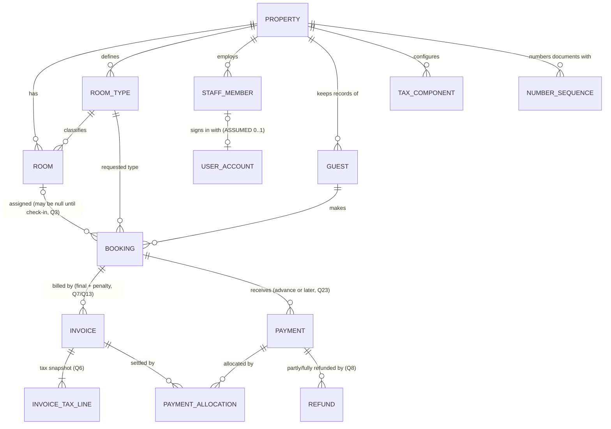
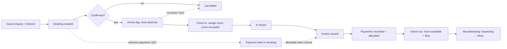
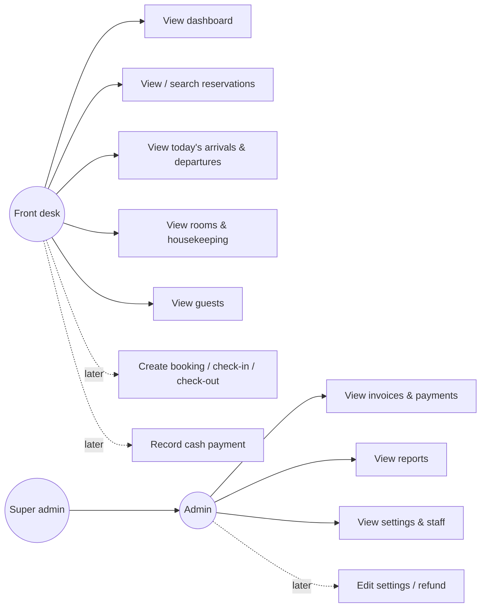
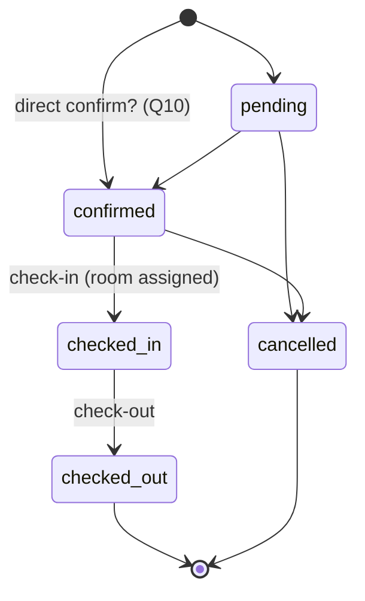
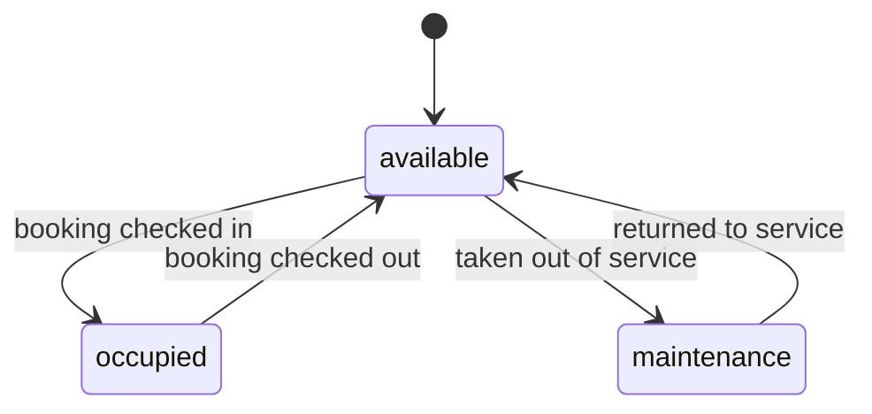
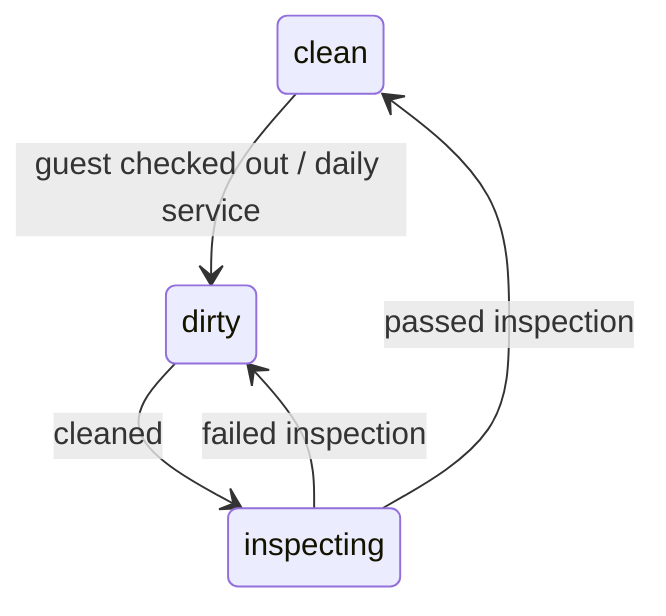
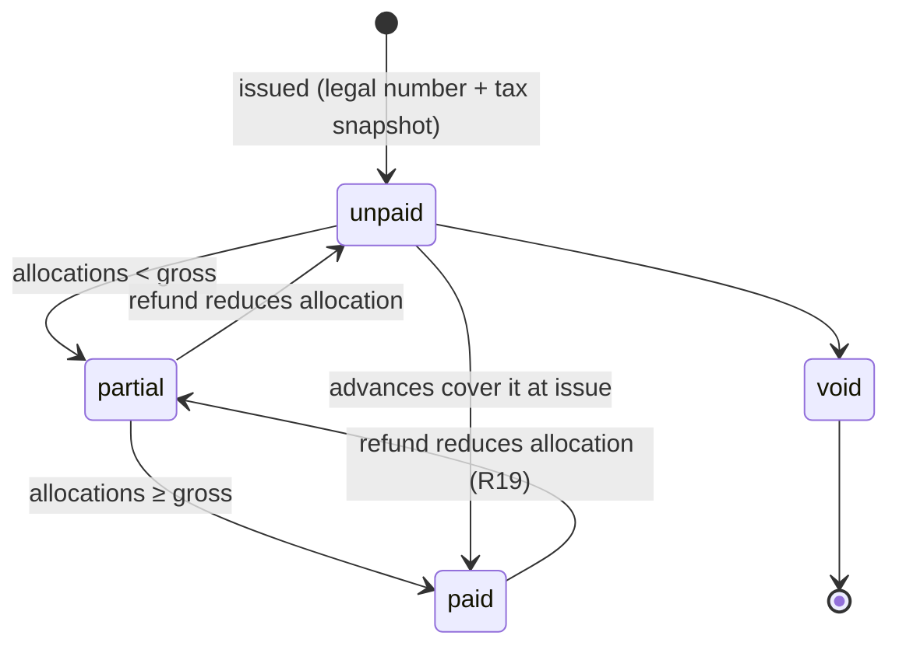
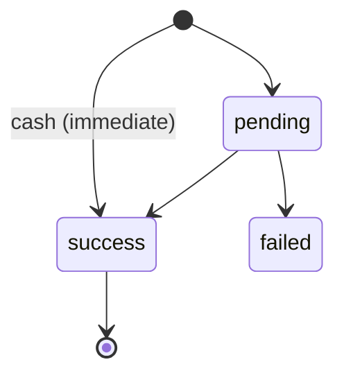
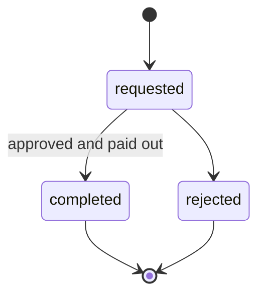

# Domain model: StayDesk hotel operations (Gate 1, draft for approval)

> **Role:** Domain Analyst (with Business Analyst for rules and Data Analyst for derived values).
> **Status:** **APPROVED (Gate 1, 2026-11-09), revision 3.** Next: Gate 2 database design
> ([../DATABASE.md](../DATABASE.md)). No migrations or code until Gate 2 is approved. Open questions
> remain open: approval fixes the model's structure, and the working assumptions stay tagged ASSUMED.
> **Revision 2 changes:** single property with `property_id` (Q1), configurable tax components with
> invoice snapshots (Q6), payments received before invoicing and allocated to invoices (Q23), refunds
> as separate records (Q8), uniqueness vs gap-free numbering (Q11), unresolved cancellation policies
> (Q13), housekeeping permission and initial role boundaries (Q14), and retention and compliance as
> production blockers (Q19).
> **Revision 3 changes:** new §6a, which states the financial invariants Gate 2 must enforce:
> allocation and refund limits under concurrency, concurrent-safe invoice numbering and the
> treatment of voided numbers, advances as liabilities, and immutable tax snapshots. Also new Q24 (tax
> on advances).
> **Sources read:** `src/types/modules.ts`, `src/types/dashboard.ts`, `src/api/auth.api.ts`,
> `src/api/endpoints.ts`, `src/api/modules.api.ts`, `src/api/mock/*.ts`, `src/server/bff/allowlist.ts`,
> `src/routes/*.tsx`, `src/features/dashboard/Dashboard.tsx`, `docs/ARCHITECTURE.md`, `docs/screens/*`.
> **Tags:** **OBSERVED** = seen in code · **INFERRED** = follows from code but not stated ·
> **ASSUMED** = our working decision, needs confirmation · **UNKNOWN** = see `OPEN_QUESTIONS.md` (Q#).
>
> The frontend types say "Provisional shapes". The UI is not the requirement. The shapes below are
> evidence of intent, not a contract.

---

## 0. Fixed decisions carried in from the plan (user-approved 2026-11-09)

| # | Decision |
|---|---|
| D1 | The Cookie BFF auth stays unchanged. The JWT lives only in an HttpOnly cookie, and the BFF sends a Bearer token to Express. |
| D2 | Room status is `available \| occupied \| maintenance`. There is **no `reserved`**. Occupancy is derived from actual check-in. |
| D3 | A **user account** (login identity) and a **staff member** (the person) are separate business objects. |
| D4 | Money uses decimals, never floats. Financial writes run in transactions. |
| D5 | First backend release is read-only. Mutations come later, and the UI must not pretend they work. **Amended by D6.** |
| D6 | **Demo scope (user-approved 2026-11-09, D-A).** Release 1 adds exactly eight actions for the demo journey: create guest, create booking, confirm booking, assign room (at check-in only), check in, record payment/advance, check out, and issue the final invoice (automatically at checkout). Everything else stays read-only or deferred: refunds, void, penalties, PDF, extras, exports, housekeeping updates. |

### Demo-scope business decisions (user-approved 2026-11-09)

These are user decisions. They replace the working assumptions for the questions named.

| # | Decision | Replaces |
|---|---|---|
| D-B | Staff explicitly confirm a normal booking (`pending → confirmed`). Walk-in bookings (`source = walk_in`) are created as `confirmed`. A payment never confirms a booking. | Q10 |
| D-C | The final stay invoice is issued **automatically at checkout**, in the checkout transaction. The **server** builds the lines and amounts from the booking (nights × the booking's `nightly_rate` snapshot) and the tax components in effect. The client never sends prices or lines. | Q7 (timing) |
| D-D | Checkout is allowed with an outstanding balance. The UI shows a clear warning first, and the balance due stays correct afterwards. | Q12 |
| D-E | Booking references continue the existing `BK-` sequence (the first new one follows BK-10430). Payment references are server-generated with the `PAY-` prefix. Both are generated safely under concurrency, and the client never supplies either. | Q11 (bookings, payments) |
| D-F | For the demo, a room is assigned **only at check-in**. Check-in validates room type, maintenance (out of service), date availability and occupancy. | Q3 |
| D-G | Admin revenue = **invoiced net** (excluding tax) of **issued** invoices. Void invoices and unallocated advances are excluded. | Q16 |
| D-H | After checkout the room shows **Available + Dirty**. No mark-clean action in the initial demo. | Q14 (demo only) |
| D-I | No DB booking-status guard until the T2b result has been reported and a separate design decision is made. | — |

Boundaries kept: the JWT stays in the HttpOnly BFF cookie (D1). The server owns every financial
calculation and every reference. Allocation and refund limits stay service-enforced, with no new
triggers for them. Duplicate payment submission must be prevented. P0 concurrency protections stay.
Existing demo data is not changed.

---

## 1. Actors

| Actor | Evidence | Tag |
|---|---|---|
| Front desk staff | Auth role `front_desk` (`auth.api.ts`). Staff role label "Receptionist" (`settingsMock`) | OBSERVED |
| Admin | Auth role `admin` | OBSERVED |
| Super admin | Auth role `super_admin` | OBSERVED |
| Manager, Housekeeping, Accounts | Staff *job* labels in `settingsMock.staff[].role`. There is no matching auth role | OBSERVED (labels). Their mapping to permissions is UNKNOWN (Q14) |
| Guest | Business object only. There is no guest login (`/public` routes are denied in the BFF) | OBSERVED (no guest-facing UI) |
| Booking channel (Booking.com, Expedia…) | Booking `source` values. Whether they integrate or are only labels is UNKNOWN (Q9) | OBSERVED (labels) |

## 2. Business goal

Run the daily operation of **one property** in Release 1 (INFERRED from the single
`SettingsData.property`, and confirmed by the user for Release 1 in Q1). Property-owned records carry
a `property_id` so that more properties can be added later. Release 1 has no multi-tenant
administration (Q1). The operation covers the room inventory and its condition,
reservations and stays, arrivals and departures, guest records, billing and payments, and management
reporting.

## 3. Preconditions

- A staff member signs in through the BFF with a valid user account (OBSERVED, `docs/screens/login.md`).
- The property is configured with currency, timezone, check-in/out times and tax rate (OBSERVED fields).
- Rooms and room types exist before a booking can reference them (INFERRED).

## 4. Inputs (as the frontend currently shows them)

Booking: guest, room, room type, check-in date, check-out date, number of guests, source, total
(OBSERVED `Booking`). Room: number, floor, type, rate, capacity (OBSERVED `Room`). Guest: name,
email, phone, country, VIP flag (OBSERVED `Guest`). Payment: invoice, date, method, amount
(OBSERVED `Payment`). Property settings and the staff list (OBSERVED `SettingsData`).

## 5. Entities and relationships

| Entity | Key attributes (from types) | Identity | Tag |
|---|---|---|---|
| **Property** | name, address, phone, email, currency (`INR`), timezone (`Asia/Kolkata`), checkInTime `14:00`, checkOutTime `11:00` | one row in Release 1. It owns every record below through `property_id` | OBSERVED fields. Single property for Release 1 is decided (Q1). `taxRate` moves to TaxComponent |
| **TaxComponent** | name (e.g. GST, or CGST/SGST), rate, effective from / to, order of application, applies to (room nights, penalties…) | `id` | ASSUMED (Q6). The frontend has only a single `taxRate: 12` (OBSERVED), which is sample data and is never hardcoded |
| **UserAccount** | username, password hash, role (`front_desk\|admin\|super_admin`), active | `id` (number in `SessionUser`) | OBSERVED (`SessionUser`). Password hash is ASSUMED (D-safeguards) |
| **StaffMember** | name, email, job title (Receptionist/Manager/…), active | `id` | OBSERVED (`settings.staff`). Its link to UserAccount (0..1) is ASSUMED, per D3 and Q14 |
| **RoomType** | name (Standard/Deluxe/Suite), base rate, capacity | name | INFERRED. Mock rate and capacity depend only on type, and the allowlist has `/api/room-types` |
| **Room** | number (e.g. `204`), floor, type, operational status, housekeeping status, rate | number, unique per property | OBSERVED. Whether rate is per room or per type is UNKNOWN (Q5) |
| **Guest** | name, email, phone, country, VIP | `id` | OBSERVED. `stays` and `lastStay` are **derived** (§9) |
| **Booking** | reference (`BK-10430`), guest, room, check-in, check-out, guests count, source, status, total | reference, unique | OBSERVED. One room per booking (single `roomNumber`) is OBSERVED in shape. Whether a booking can have several rooms is UNKNOWN (Q2) |
| **Invoice** | legal number (`INV-2026110`), booking, issued date, net amount, tax total, gross amount, status | internal `id`, plus a legal number unique per property (gap-free is Q11) | OBSERVED (`number`, `amount`, `tax`, `status`). One invoice per booking is INFERRED from the mock (1:1). A separate penalty invoice is ASSUMED (Q7, Q13) |
| **InvoiceTaxLine** | invoice, component name, rate, taxable base, tax amount, **copied at issue time** | `id` | ASSUMED (Q6). This is the tax snapshot, so an issued invoice never changes when tax configuration does |
| **Payment** (money received) | reference (`PAY-55010`), **booking**, received date, method (`Card\|UPI\|Cash\|Bank transfer`), amount, status (`pending\|success\|failed`) | reference, unique | OBSERVED (fields). Belonging to the booking rather than the invoice, so it can arrive before invoicing, is ASSUMED (Q23). It is **never modified after `success`** (Q8) |
| **PaymentAllocation** | payment, invoice, allocated amount, allocated at | `id` | ASSUMED (Q23). It links payments and invoices many-to-many. Unallocated money is the booking's advance |
| **Refund** | reference, **original payment**, amount, date, method, reason, status, approved by | reference, unique | ASSUMED (Q8). Several partial refunds per payment are allowed. The original payment row is untouched |
| **NumberSequence** | property, document type (invoice, …), financial-year prefix, next value | property + type + year | ASSUMED (Q11). This gives a gap-free legal number, which `AUTO_INCREMENT` cannot (R14) |

Every property-owned entity carries `property_id` (Q1). The diagram shows only the main property
links, to keep it readable.

**Change from revision 1:** a payment used to belong directly to an invoice. It now belongs to the
**booking** and reaches invoices through **PaymentAllocation**. This lets an advance be received
before any invoice exists (Q10, Q23), lets one payment cover a room invoice and a penalty invoice, and
lets one invoice be settled by several payments. Refunds are their own records (Q8). All of this is
ASSUMED and depends on Q23.

**Key distinction (D3):** the frontend only has *names* on bookings, invoices and payments
(`guestName`, OBSERVED). The domain links them by identity (Guest id, Booking id, Invoice id). The
names are display projections and are never the join key (INFERRED: the names in the mock repeat
across entities).

## 6. Business rules

| # | Rule | Tag |
|---|---|---|
| R1 | Room operational status is one of `available`, `occupied`, `maintenance` | **ASSUMED (D2)**. The frontend has an extra `reserved` (gap G1) |
| R2 | A room is **occupied** only while a booking assigned to it is `checked_in` | ASSUMED (D2) |
| R3 | A confirmed booking without an assigned room changes no room's status | ASSUMED (D2) |
| R4 | Housekeeping status (`clean`, `dirty`, `inspecting`) is **independent** of operational status | INFERRED. The two are separate fields and columns on Rooms |
| R5 | Check-out date is after the check-in date. The number of nights is check-out minus check-in | INFERRED (the mock computes `checkOut = checkIn + nights`) |
| R6 | Booking total = nightly rate × nights | INFERRED (`total: room.rate * nights`). Seasonal rates, discounts and extras are UNKNOWN (Q5) |
| R7 | Guests on a booking must not exceed the room capacity | INFERRED (`capacity` exists). This needs confirmation (Q4) |
| R8 | A room cannot hold two overlapping active bookings | INFERRED (basic inventory). Overbooking policy is UNKNOWN (Q3) |
| R9 | Invoice tax is calculated from the **tax components configured for the property and in effect on the issue date**. No rate is hardcoded. The 12% in the mock is sample data only. Invoice gross = net + the sum of tax lines (tax-exclusive pricing) | OBSERVED: the mock computes `amount = total×1.12`, `tax = total×0.12` from `taxRate: 12`. Configurable components are ASSUMED (Q6). Slabs, inclusive pricing and rounding are UNKNOWN (Q6) |
| R9a | When an invoice is issued, each applied tax component is **copied onto it** (name, rate, base, amount). Later configuration changes never recalculate an issued invoice | ASSUMED (Q6) |
| R10 | Invoice status follows **allocated** payments, net of refunds: `unpaid` (nothing allocated), `partial`, `paid` (allocated ≥ gross), or `void` (cancelled, excluded from billed totals) | INFERRED (the mock and the Invoices screen exclude `void` from "Billed"). "Via allocations" is ASSUMED (Q23) |
| R11 | Only `success` payments count as money received. Net received = successful payments − completed refunds | INFERRED (the Payments "Received" stat sums `success`). Subtracting refunds is ASSUMED (Q8) |
| R12 | Nothing can be allocated to a void invoice | INFERRED (the mock creates payments only for non-void invoices) |
| R13 | Money is held in property currency (INR) as a decimal with 2 places | ASSUMED (D4). The mock stores whole numbers |
| R14 | Booking reference, invoice number, payment reference, refund reference and room number are **unique per property**. A unique constraint guarantees uniqueness only. A **gap-free** legal invoice series is a separate requirement: it needs a per-property counter, incremented in the same transaction that issues the invoice, and the number is assigned at issue time, not on draft creation. `AUTO_INCREMENT` ids can skip values (rollbacks, failed inserts, restarts), so they are internal ids, never the legal number | OBSERVED (formats). The legal gap-free requirement and the financial-year reset are UNKNOWN (Q11) |
| R15 | Disabled staff (`active=false`) cannot sign in | ASSUMED (D3). This needs confirmation (Q14) |
| R16 | A payment can be received **before any invoice exists** (an advance) and is held against the booking. When an invoice is issued, available booking payments are allocated to it | ASSUMED (Q10, Q23) |
| R17 | The sum of allocations from a payment cannot exceed that payment's amount minus its refunds. The sum of allocations to an invoice cannot exceed its gross amount | ASSUMED (Q23) |
| R18 | A refund is a **new record** against one original payment. The original payment is never edited or deleted. Several partial refunds are allowed while total refunds ≤ the payment amount | ASSUMED (Q8, as directed in the Gate 1 review) |
| R19 | A refund of money already allocated to an invoice first reduces that allocation (and so reopens the invoice balance), in the same transaction | ASSUMED (Q8, Q23) |
| R20 | Cancellation of a **paid or partly paid** booking does not decide the money automatically. Any refund, penalty or credit is an explicit, recorded decision. The policy itself is unresolved | ASSUMED (Q13) |
| R21 | Housekeeping status is updated by an authorised **front_desk** (or higher) user in Release 1. There is no housekeeping login role | ASSUMED (Q14) |

## 6a. Financial invariants and how they must be enforced (revision 3)

These are **domain requirements that Gate 2 must satisfy**. They are not table definitions. The
"Enforcement" column says what kind of guarantee is required, and Gate 2 must show exactly how its
design meets each one. All rows are ASSUMED (agreed direction from the Gate 1 review) unless tagged
otherwise.

**Why constraints alone are not enough:** MySQL `CHECK` constraints and unique keys only see **one
row**. Rules about *sums across rows* (total allocations, total refunds) cannot be a single
constraint. They must be enforced inside **one database transaction that locks the affected parent
rows first** (`SELECT … FOR UPDATE` on InnoDB), so two concurrent requests cannot both pass the check.
Row-level constraints stay as a second line of defence.

### F1. Payment allocation and refunds

| # | Invariant | Enforcement required |
|---|---|---|
| F1.1 | Every amount (payment, allocation, refund, invoice line) is a positive decimal (2 places). There are no zero or negative rows: a reversal is a separate record, not a negative one | Row constraint (`CHECK amount > 0`, `DECIMAL`), plus validation in the service |
| F1.2 | **Σ allocations of a payment ≤ payment amount − Σ completed refunds of that payment** | Transactional check with the **payment row locked** |
| F1.3 | **Σ allocations to an invoice ≤ invoice gross amount** (never more than its balance) | Transactional check with the **invoice row locked** |
| F1.4 | **Σ refunds (requested + completed) of a payment ≤ payment amount**. A pending refund reserves its amount, so two refund requests cannot together exceed it | Transactional check with the **payment row locked** |
| F1.5 | A refund of money that is already allocated must reduce that allocation in the **same** transaction (R19), so F1.2 still holds afterwards | One transaction covering the refund and the allocation change |
| F1.6 | Only `success` payments can be allocated or refunded. A void invoice accepts no allocation (R12) | Transactional check plus validation |
| F1.7 | Financial rows are **never updated in their amounts or deleted** after they take effect. Corrections are new rows (refund, void, reversed allocation) | No update or delete path in the API. DB permissions for the app user to be considered in Gate 2 |
| F1.8 | **Every financial change is one atomic transaction**: payment, allocation, refund, invoice issue, void. A failure rolls everything back | A service-layer transaction around each business event (D4) |
| F1.9 | **Lock order is fixed** (booking → payment(s) → invoice(s) → number sequence), so concurrent events cannot deadlock each other | Coding rule, documented in Gate 2 and checked in review |

### F2. Invoice numbering under concurrency

| # | Invariant | Enforcement required |
|---|---|---|
| F2.1 | **Two users issuing invoices at the same moment never get the same number** | (a) The issuing transaction locks the property's sequence row (`SELECT … FOR UPDATE`), so the second request **waits** until the first commits, then reads the incremented value. (b) A **unique key on (property, series, number)** is the backstop: if (a) were ever bypassed, the insert fails instead of creating a duplicate |
| F2.2 | **No gaps** (if Q11 confirms a gap-free series is required): the counter increment and the invoice insert commit or roll back **together**, so a failed issue releases nothing | The same transaction as F2.1. `AUTO_INCREMENT` is never used as the legal number (R14) |
| F2.3 | A number is assigned **only when the invoice is issued**. Drafts or previews have no legal number | A service rule. The number column is filled only by the issue event |
| F2.4 | **Voided invoices keep their number.** The row stays, with status `void`, a void reason, who voided it and when. The number is **never reused, renumbered or deleted**, so the sequence stays complete for audit | No delete path. Void is a status change plus audit, done in a transaction |
| F2.5 | A correction after voiding is a **new invoice with a new number**, referencing the void one | A service rule. Whether a credit note is needed instead is UNKNOWN (Q11e) |
| F2.6 | Lock contention is acceptable: the sequence lock is held only for the short issue transaction, with one row per property and series | A performance note for Gate 2 |

### F3. Advance payments are liabilities, not revenue

| # | Invariant | Enforcement required |
|---|---|---|
| F3.1 | Money received but **not allocated to an issued invoice** is a **customer advance (a liability)**: the hotel owes the stay or a refund. It is **never counted as earned revenue** | Reporting rule, in all dashboard and report queries |
| F3.2 | Revenue is recognised from **issued, non-void invoices** (net of tax), not from payments received. Cash received is reported separately from revenue | Reporting rule. The revenue basis is confirmed in Q16 |
| F3.3 | Advances held must stay **visible**: per booking (balance, front desk), and in total as "Advances held" for management | A derived value (§9), shown in a report or on the dashboard (Gate 3/4) |
| F3.4 | Money on a **cancelled** booking stays an advance (liability) until a recorded decision turns it into a refund, a penalty invoice (only then revenue) or credit (R20) | Follows from F3.1 and R20 |
| F3.5 | Tax on advances: whether tax is due when an advance is received is UNKNOWN (Q24). The design must not assume either way | Open, see Q24 |

### F4. Tax snapshots are immutable

| # | Invariant | Enforcement required |
|---|---|---|
| F4.1 | When an invoice is issued it stores, per applied component: **component code and name, rate, taxable base, calculated tax amount**. It also stores invoice-level **net, tax total and gross**. Nothing is recalculated from configuration later | Stored columns on the invoice and its tax lines, written by the issue event |
| F4.2 | An issued invoice's lines, tax lines and totals are **read-only**. The only allowed change is status → `void` (F2.4) | No update path in the API. A void is the only mutation |
| F4.3 | Tax configuration is **never edited in place** once used. A rate change is a new component row with a new effective-from date, and the old row is end-dated. This keeps the history of which rate applied when | A service rule for settings edits (later release) |
| F4.4 | The rounding rule used is part of the snapshot or fixed per invoice, so reprinting gives identical figures | Rounding rule TBD (Q6c) |

## 7. Workflow and business events

Each event answers "what happens when the user does X?". **Every event below is a mutation and is out
of scope for the first release (D5).** They are listed so the schema supports them later.

| Event | Who (ASSUMED) | State changes | Tag |
|---|---|---|---|
| **Booking created** | front_desk+ | Booking enters `pending` or `confirmed` (which one is Q10). It needs a guest (existing or new) and dates. A room may be unassigned (Q3) | INFERRED |
| **Booking confirmed** | front_desk+ | `pending → confirmed`. No room change (R3) | INFERRED (allowlist `/confirm`) |
| **Guest checked in** | front_desk+ | Booking `confirmed → checked_in`. A room is assigned if it wasn't already. Room `available → occupied`. The front-desk arrival shows `done` | INFERRED (allowlist `/check-in`) |
| **Guest checked out** | front_desk+ | Booking `checked_in → checked_out`. Room `occupied → available`. Housekeeping goes to `dirty`, and the invoice is finalised. Whether a balance must be zero first is Q12 | INFERRED (allowlist `/check-out`). The housekeeping step is ASSUMED |
| **Booking cancelled (unpaid)** | front_desk+ | `pending/confirmed → cancelled`. No financial record | ASSUMED (Q13a) |
| **Booking cancelled (partly or fully paid)** | front_desk+ cancels, admin+ decides the money | `→ cancelled`. Received payments stay as an **unallocated advance** until someone decides: refund (Refund records), keep as penalty (a penalty invoice is issued and the advance is allocated to it), or keep as credit. Every option is an unresolved policy | UNKNOWN (Q13b–g). Holding the money is ASSUMED (R20) |
| **No-show** | — | There is no status for it today. Penalty unresolved | UNKNOWN (Q13f) |
| **Advance received** | front_desk+ | A payment is created against the **booking** with no invoice yet. It may move the booking `pending → confirmed` | ASSUMED (Q10, Q23) |
| **Payment recorded** | front_desk+ | A payment is created against the booking (`pending` or `success`). If an issued invoice is open, it is allocated to that invoice. The invoice status is recalculated, all in one transaction (D4) | INFERRED (allowlist `/payments/cash`). Allocation is ASSUMED (Q23) |
| **Invoice issued** | front_desk+ | Takes the next legal number from the per-property sequence. Tax components are snapshotted onto the invoice. The booking's unallocated payments are allocated to it. All of this is one transaction (R14, R9a, R16) | ASSUMED (Q6, Q11, Q23) |
| **Refund issued** | admin+ | A new Refund record against the original payment (partial or full, possibly one of several). Affected allocations are reduced and invoice status recalculated, in one transaction. The original payment is unchanged | ASSUMED (Q8, R18, R19) |
| **Room to maintenance / back** | admin+ | `available ↔ maintenance`. This is blocked while occupied | INFERRED. The role is ASSUMED |
| **Housekeeping update** | front_desk+ (on behalf of housekeeping staff) | `dirty → inspecting → clean` | INFERRED (the values). The role is ASSUMED (Q14, R21) |
| **Settings / tax configuration edited** | admin+ | Property fields or tax components change, with effective dates. Issued invoices keep their snapshot (R9a) | ASSUMED (Q6) |

### Use cases (actor → goal)

Solid lines are first-release reads (D5). Dotted lines are later mutations. Which role sees which
screen is UNKNOWN (Q15). The UI does not gate by role today (OBSERVED, `docs/screens/README.md`).

## 8. State machines

### Booking (OBSERVED values `pending, confirmed, checked_in, checked_out, cancelled`)

The transitions are INFERRED from the allowlist actions (`confirm`, `check-in`, `check-out`,
`cancel`). No-show and modifying dates are UNKNOWN (Q13).

### Room operational status (ASSUMED, D2)

There is no `occupied → maintenance` transition while a guest is in house (INFERRED). An open
question is whether `occupied` should be **stored** or **computed** from bookings (proposal: computed,
with `maintenance` as the only stored flag). That is a Gate 2 decision.

### Housekeeping (OBSERVED values `clean, dirty, inspecting`, independent of the above)

The transitions are INFERRED from the names.

### Invoice (OBSERVED values `unpaid, partial, paid, void`)

Whether this status is derived from allocations or stored is a Gate 2 decision (proposal: derived,
with `void` stored). Whether a partly paid invoice can be voided (with the allocations released back
to an advance) is UNKNOWN (Q13).

### Payment (OBSERVED values `pending, success, failed, refunded`)

**Revision 2:** `refunded` is no longer a payment state. A successful payment stays `success`
forever, and refunds are separate records against it (R18). "Fully refunded" and "partly refunded"
are **derived** from the sum of its refunds. The frontend's `refunded` payment status is gap G9.

### Refund (ASSUMED, Q8)

Whether approval is a separate step, and what happens when a bank refund fails, is UNKNOWN (Q8a, Q8d).

## 9. Derived (computed, not stored) values

| Value | Screen | Proposed derivation | Tag |
|---|---|---|---|
| Dashboard room counts (`available/occupied/maintenance`) | Dashboard | count rooms by R1/R2 | INFERRED. `reserved` count is gap G1 |
| `checkInsToday` / `checkOutsToday` | Dashboard | bookings with check-in or check-out = today (property timezone) | INFERRED |
| `bookingsToday` | Dashboard | bookings *created* today | ASSUMED (the label "New bookings") |
| `revenueToday` / `revenueMonth` | Dashboard | Is it payments received or invoices issued? Is `null` used to hide figures from some roles? | UNKNOWN (Q16) |
| `occupancyWeek[].rate` | Dashboard | occupied room-nights ÷ sellable room-nights per day | INFERRED. Whether maintenance rooms count as sellable is Q17 |
| Arrivals / departures (`Movement`, `FrontDeskItem`) | Dashboard, Front desk | a view over bookings for today. `status done` = checked in or out | INFERRED (the mock builds front desk from dashboard movements) |
| `FrontDeskItem.time` | Front desk | expected arrival time per booking, or property check-in time? | UNKNOWN (Q18) |
| `FrontDeskItem.balance` | Front desk | before invoicing: booking total + expected tax − net booking payments. After invoicing: invoice gross − net allocations | INFERRED ("balance due"). The formula is ASSUMED (Q12, Q23) |
| Booking advance (unallocated) | — (no screen yet) | net successful booking payments − allocations. This is a **liability, never revenue** (F3.1) | ASSUMED (Q23) |
| Advances held (total) | — (Gate 3/4: dashboard or report for admin+) | Σ unallocated advances across bookings | ASSUMED (F3.3) |
| Payment refunded / partly refunded | Payments | sum of completed refunds vs payment amount | ASSUMED (Q8). Replaces the stored `refunded` status (G9) |
| `Guest.stays`, `Guest.lastStay` | Guests | count and max of checked-out bookings | INFERRED |
| "Repeat guests", "International" | Guests | `stays > 1`, and `country ≠ India` (the property's country) | OBSERVED (UI logic). The hardcoded "India" is gap G6 |
| Reports `months[]` revenue, occupancy, ADR | Reports | revenue per month. ADR = room revenue ÷ room-nights sold | INFERRED (industry definition). The revenue basis is Q16 |
| Reports `bySource`, `byRoomType` | Reports | group bookings by source, and revenue by room type | INFERRED |
| Invoice/Payments stat tiles | Invoices, Payments | sums over the list (excluding void, and `success` only) | OBSERVED (UI logic) |

## 10. Permissions (role × capability)

The roles are OBSERVED, and the hierarchy `front_desk < admin < super_admin` is OBSERVED
(`docs/screens/README.md`). **Per-screen access is UNKNOWN (Q15).** Below are the **initial permission
boundaries** (ASSUMED, for confirmation in Q14/Q15). Release 1 implements only the "read" rows (D5).
The others define the limits that later mutation releases must respect. Every boundary is enforced
server-side, deny by default.

| Capability | front_desk | admin | super_admin | Release 1 |
|---|---|---|---|---|
| Dashboard, Reservations, Front desk, Rooms, Guests (read) | ✓ | ✓ | ✓ | read |
| Invoices, Payments (read) | ✓ | ✓ | ✓ | read |
| Revenue figures on the dashboard, Reports | ✗ (Q16) | ✓ | ✓ | read |
| Settings, tax configuration and staff (read) | ✗ | ✓ | ✓ | read |
| Create, confirm, check in, check out and cancel bookings | ✓ | ✓ | ✓ | later |
| **Update housekeeping status** (on behalf of housekeeping staff) | ✓ | ✓ | ✓ | later (R21) |
| Record payments and advances, issue invoices | ✓ | ✓ | ✓ | later |
| Decide refunds, penalties or credit on cancellation; issue refunds | ✗ | ✓ | ✓ | later (Q8a, Q13g) |
| Void an invoice | ✗ | ✓ | ✓ | later |
| Room maintenance on/off | ✗ | ✓ | ✓ | later |
| Edit property settings and tax components | ✗ | ✓ | ✓ | later |
| Manage user accounts and roles | ✗ | ✗ | ✓ | later |

There is no `housekeeping` login role (OBSERVED: only three roles exist). Whether one should be added,
limited to housekeeping status only, is Q14.

Enforcement is server-side in Express (`authRequired` / `requireRole`). The BFF adds no privilege
(OBSERVED, `docs/ARCHITECTURE.md`).

## 11. Audit

- Nothing is audited today: no audit fields in any type (OBSERVED).
- Proposal (ASSUMED): every financial and status-changing event records who, when, from-state and
  to-state. Payments and invoices are never hard-deleted (void or refund instead). Logins record
  success and failure without passwords or tokens.
- Financial records (payments, allocations, refunds, invoices, tax snapshots) are append-only:
  corrections are made with new records (refunds, voids), never by editing (ASSUMED, R18, R9a).
- Gap-free invoice numbering (if Q11 confirms it is required) is auditable: a voided number stays
  visible as void and is never reused (ASSUMED, Q11d).
- Guest PII (email, phone) appears in lists (OBSERVED). **Retention periods, guest-registration
  compliance (ID capture, foreign-guest reporting), the applicable data-protection law, PII masking
  and financial-record retention are explicit production-release requirements (Q19).** They are
  UNKNOWN today. Release 1 may run as a demo without them, but must not go to production until they
  are answered.

## 12. Exceptions

| Situation | Expected behaviour | Tag |
|---|---|---|
| Overlapping booking for the same room | reject | INFERRED (R8). Overbooking is Q3 |
| Check-in before the check-in date, or with no room available | ? | UNKNOWN (Q3, Q20) |
| Check-out with a balance due | ? | UNKNOWN (Q12) |
| Payment greater than the balance | reject, or keep as credit? | UNKNOWN (Q8c) |
| Allocation to a void invoice | reject | INFERRED (R12) |
| Refund greater than the payment amount minus earlier refunds | reject | ASSUMED (R18) |
| Cancellation of a paid or partly paid booking | money held as an advance until an admin decides refund, penalty or credit | ASSUMED (R20). Policy UNKNOWN (Q13) |
| Invoice issue fails partway (e.g. DB error) | the whole transaction rolls back. If a gap-free series is required, the counter rolls back with it, so no number is lost | ASSUMED (R14, Q11) |
| Room in maintenance with future bookings | ? | UNKNOWN (Q21) |
| Tax rate changed after invoices were issued | old invoices keep their rate | ASSUMED |
| Upstream or DB down | the BFF returns 502/503 and the UI shows an error | OBSERVED (BFF limits) |

## 13. Reports

These are OBSERVED in `ReportData`: monthly revenue, occupancy and ADR (6 months), bookings by
source, and revenue by room type. Export is OBSERVED in the allowlist (`/api/reports/:seg/export`)
but no UI exists. Format and filters are UNKNOWN (Q22).

## 14. Open questions

See [OPEN_QUESTIONS.md](OPEN_QUESTIONS.md), Q1–Q24. Q23 (payments before invoicing, and allocation)
is the question that decides the payment ↔ invoice relationship in §5.

---

## 15. Frontend ↔ domain gaps (for Gates 2–4, not changed now)

| # | Gap | Where | Proposed handling |
|---|---|---|---|
| G1 | **`reserved` room status** conflicts with D2 | `RoomStatus` in `src/types/dashboard.ts`, `stats.reserved` and the "Reserved" tile in `Dashboard.tsx`, the `tone.reserved` badge in `src/routes/rooms.tsx`, and `dashboard.mock.ts` | Gate 4: remove `reserved` from the type, the tile and the mock. If "booked today, not yet arrived" is still wanted, show it as an *arrivals expected* count (bookings), not as a room status. No mapping is invented here |
| G2 | **The BFF allowlist doesn't match the frontend endpoints** | `src/server/bff/allowlist.ts` vs `src/api/endpoints.ts`. The frontend calls `/api/dashboard`, `/api/front-desk`, `/api/invoices` (list) and `/api/reports` (no segment), and **none of these are allowlisted**, so they would 404 live. The allowlist has routes nothing calls (`/api/room-types`, `/api/availability`, booking actions, `/api/payments/cash`, `/api/payments/refunds`), all modelled on the other app | Gate 4: allowlist exactly the endpoints built in Gate 3, and drop the rest |
| G3 | **Misleading action buttons** | The Dashboard quick actions "New booking", "Add guest", "Check-in" and "Check-out" (`Dashboard.tsx:44-47`) are links to list pages. Nothing creates or checks in. The Reservations meta says "View and manage" | Gate 4: relabel (e.g. "View reservations") or disable with "Coming soon" until mutations exist (D5) |
| G4 | **Names instead of identities** | `guestName` on Booking, Invoice, Payment and FrontDeskItem | The API can keep these display fields, but the DB joins by id |
| G5 | **The mock data is internally inconsistent** | Dashboard arrivals (e.g. BK-10421 Ananya Rao, room 204) don't match `bookingsMock` (Ananya Rao is BK-10430 in a different room). Room `occupied` isn't tied to any booking. Invoice and tax use float `Math.round` | Gate 2 seeds build one consistent dataset rather than copying the mock as-is |
| G6 | **Hardcoded country** | The "International" tile in `src/routes/guests.tsx` uses `country !== "India"` | Compare against the property's country, which needs a field (Q1) |
| G7 | **Staff job roles vs auth roles** | `Receptionist/Manager/Housekeeping/Accounts` vs `front_desk/admin/super_admin` | Kept apart (D3). Mapping is Q14 |
| G9 | **`refunded` as a payment status** | `Payment["status"]` in `src/types/modules.ts`, the "Refunded" stat and badge in `src/routes/payments.tsx`, and `paymentsMock` | The domain keeps refunds as separate records (R18). Gate 3/4: the API derives a display value (e.g. `refundedAmount`, or "Partly refunded"), and the screen shows refunds without the payment's own status changing |
| G10 | **Payment belongs to an invoice in the frontend** | `Payment.invoiceNumber` (OBSERVED, single value) | The domain has booking-level payments with allocations (Q23). The API can show the allocated invoice number(s), or "Advance" when nothing is allocated yet |
| G11 | **A single `taxRate` in settings** | `SettingsData.property.taxRate` and the "Tax rate" field in `src/routes/settings.tsx` | The domain has tax components (Q6). Gate 4: Settings lists the components in effect |
| G8 | **No detail screens** | Every screen is a list. The allowlist has `/:id` detail routes that no screen calls | The first release builds list endpoints only, unless you say otherwise |
