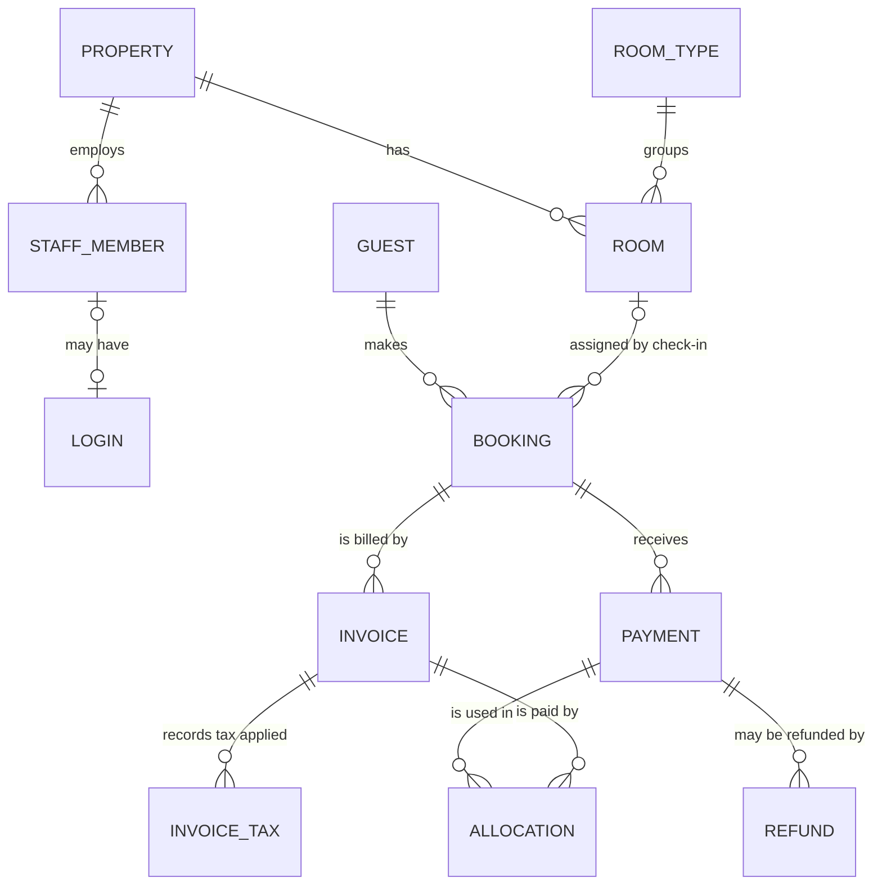
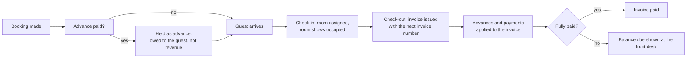

# StayDesk: data design specification

**Document status:** Draft for customer review (Gate 2). This describes what will be built. Nothing
has been built yet.
**Based on:** the approved domain model (`docs/domain/data-model.md`). The technical detail is in
`docs/DATABASE.md`.
**Open points:** listed in `docs/domain/OPEN_QUESTIONS.md` (Q1–Q24). Where a point is still open, this
document says which assumption is used.

## 1. What StayDesk keeps

| Information | What it means for the hotel |
|---|---|
| **Property** | The hotel itself: name, address, currency, time zone, check-in and check-out times. Release 1 covers one hotel |
| **Staff and logins** | A staff member (the person) is kept separately from their login. Not every staff member needs a login |
| **Room types and rooms** | Room types set the price and maximum guests. Each room has a number, a floor, a cleaning state and an out-of-service flag |
| **Guests** | Guest contact details and VIP flag. Stay history is calculated from bookings |
| **Bookings** | One room per booking, with dates, guest count, booking channel and status. The nightly price is fixed when the booking is made |
| **Invoices** | Issued bills with a legal invoice number, the tax applied and the totals |
| **Payments** | Money received for a booking, which can be before the invoice exists (an advance) |
| **Allocations** | Which payment paid which invoice, and how much |
| **Refunds** | Money returned against a payment. There can be several partial refunds |
| **Tax settings** | The tax components (for example GST) and the dates each rate applies from |
| **Activity log** | Who did what, and when, for every important action |

## 2. How the information connects

## 3. Booking to payment: the flow

## 4. Rules the system guarantees

**Money**
- Amounts are stored exactly (no rounding drift). Every amount is positive: a correction is a new
  entry, never an edit or a minus figure.
- A payment can never be applied for more than it is worth, and an invoice can never be paid more
  than its total.
- Refunds can never add up to more than the original payment. The original payment record is never
  changed.
- Every money action either completes in full or not at all.
- Money received but not yet billed is shown as **advances held**, which the hotel owes the guest. It
  is not counted as revenue.

**Invoices and tax**
- Two staff issuing invoices at the same moment always get different numbers. Numbers run in
  sequence with no gaps (to be confirmed with your accountant, Q11).
- A cancelled (void) invoice keeps its number and stays on record. Numbers are never reused.
- Each invoice keeps the tax names, rates and amounts that applied on its issue date. Changing the
  tax settings later never changes an old invoice.
- No tax rate is fixed in the software. It comes from the tax settings.

**Rooms**
- A room is either available, occupied or out of service. A booking alone does not make a room
  occupied. Only check-in does.
- Two guests can never be checked into the same room at the same time.

**Records**
- Issued invoices, payments, refunds and the activity log cannot be deleted.
- Passwords are stored only in a form that cannot be read back. Guest contact details and passwords
  never appear in the activity log.

## 5. Not included yet

These wait for your answers in the open questions:
- multi-room bookings (Q2);
- seasonal prices and extras (Q5);
- credit notes (Q11);
- guest credit (Q8);
- no-shows and cancellation penalties (Q13);
- security deposits (Q23);
- tax on advances (Q24);
- guest ID capture and data retention (Q19).

**The Q19 items must be settled before the system goes live.**
